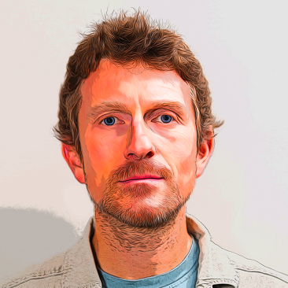

*Last update: 2026, october*

## #My_journey (english)

I'm a R&D software engineer. I have over 20 years' experience in development teams, in web environments.
I follow the original values of the agile and software craftsmanship movements.
I'm convinced of the need for Open Source and the free software approach.

Over the years, I've always programmed, designed architectures, mentored and been in contact with end-users and customers.
To carry out these complex software development tasks, it is necessary to build a global team culture
(product interest and advanced technical skills).

During my professional career, in order to improve my practices, I obtained a
[master's degree of computer science at Sorbonne University](https://sciences.sorbonne-universite.fr/formation-sciences/masters/master-informatique/parcours-stl)
(Jussieu campus, Paris, 2021-2023). This fully theoretical training focused on the design of programming langages.
I have now a strong interest in scientific research (degrowth of programming languages and their toolchains)
and I understand the importance of bringing academic and industry closer together.

I'm a Ph.D. student at [Phenix research group](https://phenix.citi-lab.fr) of INSA Lyon CITI Lab
(from July 2026 to June 2029). The subject of my PhD is
**Frugality of programming languages, relationship with software development practices**.
Like Software bloat ([bloatware](https://en.wikipedia.org/wiki/Software_bloat)),
languages and their toolchains are constantly growing. The following hypothesis will be examined to determine
whether it holds true or not:
*The proliferation of programming paradigms within a single language contributes to software growth, both in the toolchain for working with that language and in the software built using it*.

[Learn more about my PhD subject](./phd.html)

To be continued!

## #Mon_parcours (français)

Je suis ingénieur logiciel R&D avec plus de 20 ans d'expérience au sein d'équipes de développement
dans des environnements web. Adepte des valeurs radicales portées par le mouvement agile et l'artisanat du logiciel,
je suis convaincu de la nécessité de l'Open Source et sensible à la philosophie du logiciel libre.

Durant ces années, j'ai toujours programmé, imaginé des architectures, encadré, accompagné,
été au contact des utilisateurs finaux, des clients. J'ai acquis la conviction que pour mener à bien ces tâches complexes,
construire une culture d'équipe, s'inscrivant dans une culture technique avancée, une culture produit et
une culture d'entreprise adaptée, constitue une condition nécessaire.

A la moitié de ma carrière professionnelle, afin d'évoluer dans mes pratiques, j'ai passé le
[Master STL (Science et Technologie du Logiciel)](https://sciences.sorbonne-universite.fr/formation-sciences/masters/master-informatique/parcours-stl)
de Sorbonne Université (Campus Jussieu, Paris, années 2021-2023). Ce cursus théorique complet,
abordant notamment la conception des langages de programmation, a réveillé en moi un vif intérêt pour la recherche
scientifique dans le domaine du minimalisme des langages et de leurs outils de manipulation,
et la pertinence de rapprocher les milieux académiques des milieux industriels.

Je suis actuellement (de juillet 2026 à juin 2029) doctorant au sein de l'équipe de recherche
[Phenix](https://phenix.citi-lab.fr) du CITI Lab de l'INSA Lyon. Mon sujet de thèse s'intitule
**Frugalité des langages de programmation, lien avec les pratiques de développement**.
A l'instar de l'[inflation logicielle](https://fr.wikipedia.org/wiki/Bloatware), les langages et leurs outils
ne sont pas en reste. Nous avançons l'hypothèse suivante qui sera étudiée afin d'être validée ou invalidée :
*La multiplication des paradigmes de programmation au sein d'un même langage tend à favoriser l'inflation logicielle, aussi bien dans les outils de manipulation de ce langage que dans les logiciels construits avec celui-ci.*

[En savoir plus sur mon sujet de thèse](./phd.html)

A suivre !

<a href="/" class="btn">Back</a>
